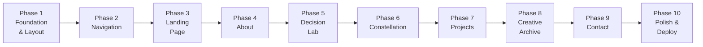

# NEXUS — Development Plan

> Phase 1 Deliverable · Foundation Architecture
> AWS Student Builder Challenge 2026

---

## 1. Technology Architecture

### Core Stack Decision

| Layer | Choice | Rationale |
|-------|--------|-----------|
| **Build Tool** | **Vite 6** | Fastest DX; native ESM; Amplify Hosting supports static SPA deploys natively with `npm run build` → `dist/`. Next.js adds SSR complexity and cold-start overhead on Amplify without clear benefit for a portfolio SPA. |
| **Framework** | **React 19** | Stable, massive ecosystem, first-class Framer Motion support |
| **Language** | **TypeScript 5.6** | Type safety for complex interactive components |
| **Styling** | **Tailwind CSS 4** | Direct token transfer from Stitch (Stitch exports Tailwind config). Zero translation friction. |
| **Animation** | **Framer Motion 12** | Declarative React animations, layout transitions, scroll-triggered reveals, gesture support |
| **Graph Engine** | **React Flow** (primary) or **D3.js** (fallback) | Constellation node graph — React Flow provides interactive pan/zoom/drag out of the box in React; D3 as fallback for custom SVG rendering |
| **Routing** | **React Router 7** | Client-side SPA routing with hash or browser history |
| **Icons** | **Material Symbols** | Matches Stitch design exactly (already uses Material Symbols Outlined) |
| **Deployment** | **AWS Amplify Hosting** | Static SPA deployment from Git; HTTPS + CDN built-in |

> [!TIP]
> **Why Vite over Next.js?**
> - NEXUS is a fully client-rendered interactive portfolio — no SSR needed
> - Amplify Hosting serves Vite builds (`dist/`) as static assets with zero configuration
> - Next.js on Amplify requires SSR compute, increasing cold starts and cost
> - Simpler deployment pipeline: `npm run build` → push → live
> - No paid API dependencies or server-side data fetching

### Optional Enhancements (Phase 2+)

| Tool | Purpose | When |
|------|---------|------|
| `@react-spring/web` | Physics-based constellation node animations | If React Flow isn't fluid enough |
| `zustand` | Lightweight state for Decision Lab scenarios | If prop drilling becomes unmanageable |
| `lenis` | Smooth scroll behavior | After core sections are built |

---

## 2. Project Directory Structure

```
d:\Nexus\
├── public/
│   ├── fonts/                          # Self-hosted font files (optional, can use Google Fonts CDN)
│   ├── assets/
│   │   ├── nexus-emblem.svg            # Brand emblem (downloaded from Stitch)
│   │   └── og-image.png               # Open Graph preview image
│   └── favicon.ico
│
├── src/
│   ├── components/
│   │   ├── layout/
│   │   │   ├── NavBar.tsx              # Fixed header with frosted glass
│   │   │   ├── NavItem.tsx             # Individual nav link with active state
│   │   │   ├── MobileMenu.tsx          # Hamburger drawer for mobile
│   │   │   ├── Footer.tsx              # Global footer
│   │   │   ├── PageLayout.tsx          # Main layout wrapper (header + main + footer)
│   │   │   └── SectionWrapper.tsx      # Consistent section padding/spacing
│   │   │
│   │   ├── ui/
│   │   │   ├── Button.tsx              # CTAButton — Primary / Secondary / Ghost variants
│   │   │   ├── StatusBadge.tsx         # Pulse / Static / Metric badge
│   │   │   ├── TelemetryChip.tsx       # Icon + label chip (footer, header)
│   │   │   ├── MetricCard.tsx          # Value + label + progress bar
│   │   │   ├── ProgressBar.tsx         # Animated colored bar
│   │   │   ├── RadioIndicator.tsx      # Selected / Unselected radio dot
│   │   │   ├── SectionLabel.tsx        # Icon + uppercase label-caps text
│   │   │   ├── DiscoveryBeacon.tsx     # Side-accent insight card
│   │   │   ├── ConsoleBar.tsx          # Telemetry status strip
│   │   │   ├── AmbientGlow.tsx         # Decorative radial gradient blobs
│   │   │   └── ScrollAnchor.tsx        # "Traverse Dimensions" scroll CTA
│   │   │
│   │   └── shared/
│   │       ├── ConstellationPreview.tsx # SVG mini-graph for hero section
│   │       ├── TopologyDiagram.tsx      # SVG flow pipeline
│   │       └── RationalePanel.tsx       # Avatar + commentary block
│   │
│   ├── sections/
│   │   ├── landing/
│   │   │   ├── HeroSection.tsx         # Complete hero with all sub-components
│   │   │   ├── TelemetryStrip.tsx      # Protocol + coordinates strip
│   │   │   ├── TypeMonument.tsx        # NEXUS title + tagline
│   │   │   ├── ArchitectBar.tsx        # Name + specialization info bar
│   │   │   └── MetricHUD.tsx           # 4-column metric grid
│   │   │
│   │   ├── about/
│   │   │   └── AboutSection.tsx        # About page (to be designed)
│   │   │
│   │   ├── decision-lab/
│   │   │   ├── DecisionLab.tsx         # Main Decision Lab page
│   │   │   ├── ConsoleHeader.tsx       # Simulation status bar + timer
│   │   │   ├── ScenarioBrief.tsx       # Crisis description card
│   │   │   ├── StrategyCard.tsx        # Selectable option card (A/B/C/D)
│   │   │   ├── MetricProjection.tsx    # Real-time 4-metric panel
│   │   │   ├── TopologyFlow.tsx        # SVG architecture pathway
│   │   │   ├── RationaleBlock.tsx      # Ankit's architectural commentary
│   │   │   └── DecisionControls.tsx    # Progress bar + Reset + Commit
│   │   │
│   │   ├── constellation/
│   │   │   └── ConstellationSection.tsx # Interactive node graph (to be designed)
│   │   │
│   │   ├── projects/
│   │   │   └── ProjectsSection.tsx     # Project archive (to be designed)
│   │   │
│   │   ├── creative-archive/
│   │   │   └── CreativeArchive.tsx     # Creative work showcase (to be designed)
│   │   │
│   │   └── contact/
│   │       └── ContactSection.tsx      # Contact section (to be designed)
│   │
│   ├── data/
│   │   ├── scenarios.ts                # Decision Lab scenario data (A/B/C/D options)
│   │   ├── metrics.ts                  # Metric card data
│   │   ├── navigation.ts              # Nav items configuration
│   │   └── constellation.ts           # Node graph data (nodes, edges, labels)
│   │
│   ├── hooks/
│   │   ├── useActiveSection.ts         # Scroll-aware active nav tracking
│   │   ├── useDecisionLab.ts           # Decision Lab state management
│   │   ├── useAnimateOnScroll.ts       # Intersection Observer animation trigger
│   │   └── useMediaQuery.ts            # Responsive breakpoint hook
│   │
│   ├── styles/
│   │   └── globals.css                 # Tailwind directives + CSS variables + custom utilities
│   │
│   ├── lib/
│   │   └── utils.ts                    # Shared utility functions (cn(), etc.)
│   │
│   ├── App.tsx                         # Root component with router
│   ├── main.tsx                        # Entry point
│   └── vite-env.d.ts                   # Vite type declarations
│
├── docs/
│   ├── DESIGN-SPECIFICATION.md         # ← Created (this phase)
│   └── DEVELOPMENT-PLAN.md            # ← Created (this phase)
│
├── stitch_nexus_interactive_engineering_portfolio/  # Original Stitch export (reference only)
│
├── index.html                          # Vite entry HTML
├── tailwind.config.ts                  # Full design system tokens
├── postcss.config.js                   # PostCSS for Tailwind
├── tsconfig.json                       # TypeScript configuration
├── tsconfig.app.json                   # App-specific TS config
├── tsconfig.node.json                  # Node TS config
├── vite.config.ts                      # Vite configuration
├── package.json                        # Dependencies + scripts
├── .gitignore
└── README.md
```

---

## 3. Dependency Plan

### Production Dependencies

```json
{
  "react": "^19.0.0",
  "react-dom": "^19.0.0",
  "react-router-dom": "^7.0.0",
  "framer-motion": "^12.0.0",
  "@xyflow/react": "^12.0.0",
  "clsx": "^2.1.0",
  "tailwind-merge": "^3.0.0"
}
```

### Dev Dependencies

```json
{
  "typescript": "^5.6.0",
  "@types/react": "^19.0.0",
  "@types/react-dom": "^19.0.0",
  "vite": "^6.0.0",
  "@vitejs/plugin-react": "^4.0.0",
  "tailwindcss": "^4.0.0",
  "@tailwindcss/vite": "^4.0.0",
  "autoprefixer": "^10.4.0",
  "eslint": "^9.0.0",
  "@eslint/js": "^9.0.0",
  "typescript-eslint": "^8.0.0",
  "eslint-plugin-react-hooks": "^5.0.0",
  "eslint-plugin-react-refresh": "^0.4.0",
  "globals": "^15.0.0"
}
```

> [!IMPORTANT]
> **Zero paid API dependencies.** All core functionality runs client-side. No backend infrastructure required for the portfolio itself.

---

## 4. Implementation Roadmap

### Phase Layout



### Detailed Phases

| Phase | Scope | Key Deliverables | Est. Effort |
|-------|-------|-----------------|-------------|
| **1. Foundation** | Project scaffold, Tailwind config with all Obsidian Telemetry tokens, global CSS, layout primitives, font loading | Vite project, `tailwind.config.ts`, `globals.css`, `PageLayout`, `SectionWrapper`, `AmbientGlow` | Core |
| **2. Navigation** | Fixed navbar, nav items, mobile hamburger menu, active section tracking, route setup | `NavBar`, `NavItem`, `MobileMenu`, React Router config, `useActiveSection` | Core |
| **3. Landing Page** | Full hero section with all sub-components, SVG constellation preview, metric HUD, scroll anchor | `HeroSection`, `TelemetryStrip`, `TypeMonument`, `ArchitectBar`, `DiscoveryBeacon`, `ConstellationPreview`, `MetricHUD`, `ScrollAnchor`, all entry animations | High |
| **4. About** | Personal narrative section following design system | `AboutSection` — must be designed to match Obsidian Telemetry aesthetic | Medium |
| **5. Decision Lab** | Interactive scenario simulation, card selection, real-time metric updates, topology diagram, commit flow | `DecisionLab` + all sub-components, `useDecisionLab`, scenario data, animation sequences | Very High |
| **6. Constellation** | Interactive node graph with skills, technologies, connections | `ConstellationSection` with React Flow or D3, `constellation.ts` data, hover interactions | Very High |
| **7. Projects** | Project showcase grid/archive with filtering | `ProjectsSection` with cards following design system | Medium |
| **8. Creative Archive** | Creative work showcase | `CreativeArchive` — photography, writing, design work | Medium |
| **9. Contact** | Contact form/info section | `ContactSection` — form, social links, CTA | Low |
| **10. Polish & Deploy** | Responsive refinement, performance optimization, accessibility audit, Amplify deployment | Cross-browser testing, Lighthouse audit, Amplify CI/CD | Medium |

---

## 5. Technical Risks & Mitigations

| # | Risk | Severity | Mitigation |
|---|------|----------|------------|
| 1 | **Constellation graph performance** — Interactive node graph with many nodes + edges could lag on mobile | 🔴 High | Use React Flow's built-in virtualization; limit visible nodes on mobile; implement `will-change` and GPU-accelerated transforms; consider Canvas rendering for 50+ nodes |
| 2 | **Tailwind v4 breaking changes** — Tailwind v4 has a new CSS-first configuration model that differs from v3 | 🟡 Medium | Stitch exports v3-style JS config. Use `@tailwindcss/upgrade` codemods or pin to v3 if v4 migration is too risky for the timeline. **Decision needed before scaffold.** |
| 3 | **Font loading FOUT/FOIT** — Three web fonts (6 weights total) can cause layout shift | 🟡 Medium | Use `font-display: swap`, preload critical fonts, self-host for reliability, implement font loading CSS strategy |
| 4 | **Mobile hamburger menu** — Not designed in Stitch | 🟡 Medium | Design a slide-out drawer matching the Obsidian Telemetry system: `surface-container-lowest` background, frosted blur, pill-style nav items |
| 5 | **5 sections without designs** — About, Constellation, Projects, Creative Archive, Contact have no Stitch mockups | 🟡 Medium | Derive all section designs from the established component library and Obsidian Telemetry tokens. Maintain visual consistency by reusing MetricCard, SectionLabel, ConsoleBar, StrategyCard patterns |
| 6 | **SVG constellation performance** — Hero's neural topology SVG uses complex gradients, filters, and animations | 🟢 Low | Keep SVG simple; use CSS animations over JS where possible; apply `transform: translateZ(0)` for GPU compositing |
| 7 | **Amplify SPA routing** — Client-side routing requires catch-all redirect | 🟢 Low | Add `public/_redirects` file: `/* /index.html 200` or configure in `amplify.yml` |
| 8 | **Material Symbols bundle size** — Full icon font is large | 🟢 Low | Use the variable font with only required icons, or switch to individual SVG icons for the ~15 icons actually used |
| 9 | **Ambient glow blobs GPU cost** — Multiple large `blur()` elements can strain mobile GPUs | 🟢 Low | Use `will-change: transform`; reduce blur radius on mobile; disable on `prefers-reduced-motion` |
| 10 | **Design token drift** — Stitch DESIGN.md mentions different hex values than the Tailwind config in code.html | 🟢 Low | The **Tailwind config in code.html is authoritative** (it's the actual rendered design). The DESIGN.md has slightly different "aspirational" hex values — use the Tailwind config values for implementation. |

---

## 6. Strict Requirements Checklist

| # | Requirement | Strategy |
|---|-------------|----------|
| ✅ | No placeholder buttons | Every button navigates, opens a section, or triggers an interactive behavior |
| ✅ | No fabricated achievements | All personal data comes from `data/` files — no hardcoded fake stats |
| ✅ | No invented project statistics | Metric cards (99.98%, 42 clusters) are **thematic decorations** of the portfolio's conceptual identity, not real data claims |
| ✅ | No generic template replacement | Implementation follows Stitch design pixel-for-pixel where designs exist |
| ✅ | No unnecessary backend | Fully static SPA — no server, no database, no paid APIs |
| ✅ | No paid APIs for core functionality | All features are client-side JavaScript/CSS |
| ✅ | Mobile usability preserved | Responsive from 320px; touch-friendly targets; mobile navigation |
| ✅ | Semantic HTML | Proper use of `header`, `nav`, `main`, `section`, `article`, `footer` |
| ✅ | Accessibility best practices | WCAG AA contrast, keyboard nav, focus management, aria attributes, reduced motion |

---

## 7. Open Questions for You

Before I begin implementation, I need your input on these decisions:

> [!IMPORTANT]
> **Decisions Needed**

1. **Tailwind version**: Should I use **Tailwind v4** (latest, CSS-first config, some migration needed from Stitch's v3 format) or **Tailwind v3** (direct 1:1 token transfer from Stitch, proven stable)?

2. **Routing strategy**: Should this be a **single-page scroll** (all sections on one page, scroll-triggered) or **multi-page SPA** (React Router with separate routes per section)?

3. **Missing section designs**: For the 5 sections without Stitch designs (About, Constellation, Projects, Creative Archive, Contact) — should I:
   - **(A)** Design them myself using the Obsidian Telemetry system, or
   - **(B)** Wait for you to provide Stitch designs for each?

4. **Content data**: Will you provide the actual project data, personal bio text, and creative archive content? Or should I create placeholder structures with clear TODO markers?

5. **Brand emblem**: The Stitch design references a logo hosted on Google Photos. Do you have the original SVG/PNG to self-host?

