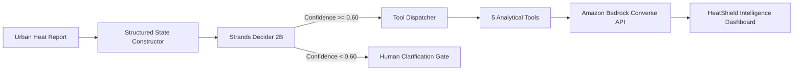
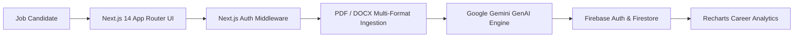
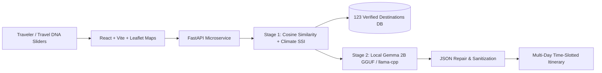
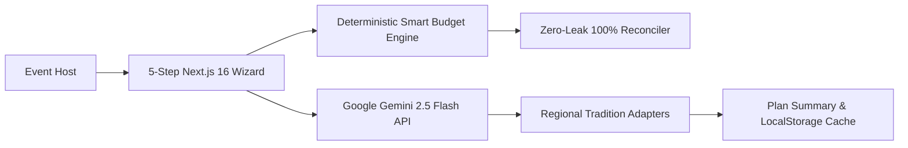

# NEXUS — Engineering Research & Project Case Studies

> Documented case studies of Ankit Singha's verified software systems and research prototypes.
> AWS Student Builder Challenge 2026 Reference Documentation

---

## Executive Summary

The projects in this archive represent applied engineering across distributed cloud architectures, autonomous AI decision systems, on-device generative language modeling, and deterministic full-stack web platforms. Each project was built to address a specific real-world bottleneck with verified technical implementations.

| Project | Domain | Key Technology | Deployment / Runtime |
| :--- | :--- | :--- | :--- |
| **HeatShield AI** | Environmental AI & Tool Gating | Amazon Bedrock + Strands Decider 2B | Vercel Serverless (FastAPI + Vite React) |
| **CareerPilot AI** | Career Intelligence Platform | Next.js 14 App Router + Google Gemini + Firebase | Next.js Full-Stack Web Application |
| **DETOURA** | Regional Travel Discovery | Local Gemma 2B GGUF + Cosine Math Engine | FastAPI Microservice + Vite Leaflet SPA |
| **Vow-Vibe-AI** | Generative Language & Budgeting | Next.js 16 + Gemini 2.5 Flash | Next.js 16 Client & Server App |

---

## Project 001: HeatShield AI

* **Official Repository**: [https://github.com/ASingha165/HeatSheild-AI](https://github.com/ASingha165/HeatSheild-AI)
* **Live Demonstration**: [https://heat-shield-sentinel.vercel.app/](https://heat-shield-sentinel.vercel.app/) (Alias: [https://heat-sheild-ai.vercel.app/](https://heat-sheild-ai.vercel.app/))
* **Context**: Engineered for the *AWS Strands Decider 2B Agent Experience Hackathon*.
* **Status**: Complete & Verified (38 passing unit and integration tests).

### The Problem
Urban municipalities receive disparate, noisy heat-wave reports during severe climate events. Municipal response teams struggle to identify whether an incoming alert warrants immediate cooling center dispatch, satellite vegetation checks, population vulnerability analysis, or request for further on-the-ground telemetry. Naive LLM agents frequently hallucinate actions or trigger expensive tools unnecessarily.

### The Solution
HeatShield AI implements a two-stage decision-and-reasoning architecture:
1. **Calibrated Tool Gating**: Evaluates structured heat reports through **Strands Decider 2B** using a pointer readout head to select one of 5 modular analytical tools with a strict confidence threshold ($\ge 0.60$). If confidence falls below 0.60, the action is safely gated for human clarification without invoking backend tools.
2. **Deterministic Tool Execution**: Executes typed Python modules:
   * `ANALYZE_HEAT`: Evaluates ambient vs. surface temperature anomalies.
   * `CHECK_VEGETATION`: Measures urban canopy deficit index.
   * `CHECK_EXPOSURE`: Computes demographic vulnerability scores.
   * `COMPARE_INTERVENTIONS`: Compares tree canopy shade vs. reflective roof coatings.
   * `REQUEST_MORE_DATA`: Formulates targeted sensor gap inquiries.
3. **Evidence-Grounded Generative Reasoning**: Feeds verified analytical outputs into the **Amazon Bedrock Converse API** (Amazon Nova 2 Lite / Claude 3 Haiku) to produce actionable municipal resilience recommendations strictly grounded in tool findings.

### System Architecture

### Verified Technology Stack
* **AI & ML**: Strands Decider 2B (Pointer Readout Head), Amazon Bedrock (`boto3` Converse API, Amazon Nova 2 Lite `global.amazon.nova-2-lite-v1:0`, Claude 3 Haiku).
* **Backend**: Python 3.10+, FastAPI, Pydantic, Uvicorn, Pytest.
* **Frontend**: React 18, Vite, TypeScript, Tailwind CSS, Lucide Icons.
* **Deployment**: Vercel Serverless (`api/index.py` Python bridge + Vite static CDN).

### Real Engineering Challenges
* **Confidence Calibration**: Balancing the gating threshold so ambiguous reports do not trigger costly tool chains while ensuring urgent 45°C+ heat alerts trigger immediate municipal intervention.
* **AWS Credential Degradation**: Crafting transparent development fallbacks so the application gracefully informs operators when temporary AWS session tokens expire rather than throwing opaque 500 errors.

---

## Project 002: CareerPilot AI

* **Official Repository**: [https://github.com/ASingha165/CareerPilot-AI](https://github.com/ASingha165/CareerPilot-AI)
* **Status**: Complete Full-Stack Web Application.

### The Problem
Job candidates experience high friction across fragmented career tools: generic resume grading engines that provide vague advice, disjointed interview preparation without real-time feedback, and static career advice disconnected from actual industry skill requirements.

### The Solution
CareerPilot AI is an end-to-end career copilot unifying document parsing, AI interview simulation, and dynamic career progression mapping:
1. **Multi-Format Resume Parser**: Ingests PDF and DOCX files via `pdf-parse` and `mammoth`, extracting candidate skill graphs, work history, and achievement metrics into structured Zod schemas.
2. **AI Mock Interview Engine**: Conducts interactive technical and behavioral interview sessions with contextual follow-up probing and real-time response evaluation.
3. **Personalized Career Roadmap**: Analyzes skill gaps against target roles and synthesizes step-by-step learning milestones.
4. **GitHub Intelligence**: Analyzes public GitHub profile activity to validate technical competencies and project frequency.

### System Architecture

### Verified Technology Stack
* **Framework**: Next.js 14.2 (App Router with Server Actions).
* **AI & Reasoning**: Google Gemini API (`@google/genai`).
* **Persistence & Auth**: Firebase Auth, Cloud Firestore (`firebase 12.19`).
* **Document Processing**: `pdf-parse`, `mammoth` (Word document parser), `formidable`.
* **UI & Validation**: React 18, TypeScript, Tailwind CSS, Radix UI Primitives, Recharts, Zod, Zustand.

### Real Engineering Challenges
* **Multi-Format Document Normalization**: Normalizing wildly varying multi-column PDF resumes and non-standard DOCX tables into a standardized data model without token truncation.
* **Context Preservation**: Structuring conversational state during multi-stage technical mock interviews to ensure follow-up questions build directly on candidate answers.

---

## Project 003: DETOURA — Regional Travel Intelligence

* **Official Repository**: [https://github.com/ASingha165/Detoura](https://github.com/ASingha165/Detoura)
* **Context**: Developed for *Hackspire '26* (Squad Brainware).
* **Status**: Complete Full-Stack System (Dataset of 123 verified destinations).

### The Problem
Overtourism concentrates travelers into a handful of hyper-commercialized tourist hubs (e.g. Darjeeling town center), degrading local ecology, driving up congestion, and overlooking dozens of pristine, culturally rich destinations across regional districts.

### The Solution
DETOURA counters overtourism through a dual-stage discovery engine:
1. **Mathematical Ranking (Stage 1)**: Matches travelers against 123 verified destinations using:
   * **Travel DNA**: Cosine similarity across Nature, Relaxation, Culture, and Adventure weights.
   * **Seasonal Climate Index (SSI)**: 12-month temperature and precipitation scoring.
   * **Crowd Pressure Index (CPI)**: Real-time congestion dampening.
   * **Underrated Gem Score**: Mathematical bonus for high-potential, low-footfall destinations.
2. **On-Device Generative AI (Stage 2)**: Employs a locally hosted, quantized **Google Gemma 2B GGUF** model (`Q4_K_M`) executed via `llama-cpp-python` to generate time-slotted morning, afternoon, and evening multi-day itineraries with zero billable cloud API tokens.
3. **JSON Repair Pipeline**: Employs a custom sanitization pipeline ensuring local quantized model responses conform strictly to frontend API contracts without parse crashes.

### System Architecture

### Verified Technology Stack
* **AI & Local Inference**: Google Gemma 2B GGUF (`Q4_K_M`), `llama-cpp-python`, `json_repair`.
* **Backend**: Python 3.12, FastAPI, Uvicorn, NumPy, Scikit-learn, SQLite (`detoura_master-v2.db`).
* **Frontend**: React, TypeScript, Vite, Tailwind CSS, Leaflet Maps.

### Real Engineering Challenges
* **Local Quantized Model Determinism**: Quantized 2B parameter models can produce slightly malformed JSON tokens under low temperature; engineered a robust JSON repair and recovery pipeline to guarantee 100% structural API contract compliance.
* **Multivariate Climate Indexing**: Aggregating 12 months of historical weather records across 23 districts in West Bengal to calculate seasonal suitability scores accurately.

---

## Project 004: Vow-Vibe-AI

* **Official Repository**: [https://github.com/ASingha165/Vow-Vibe-AI](https://github.com/ASingha165/Vow-Vibe-AI)
* **Context**: Built for *PromptWars Virtual* (Challenge 5: Celebration & Event Planner).
* **Status**: Complete Production Web Application (37/37 passing test suite).

### The Problem
Event planning requires reconciling emotionally charged creative visions (custom wedding vows, ceremonial speeches, cultural traditions) with unforgiving financial logistics. Generic AI chatbots hallucinate vendor cost allocations, miss regional customs, and fail to provide actionable financial buffers.

### The Solution
Vow & Vibe AI fuses luxury editorial design with mathematical financial discipline:
1. **Deterministic Smart Budget Engine**: Guarantees zero-rounding-leak reconciliation across 8 vendor tiers (Venue, Catering, Photography, Decor, Entertainment, Attire, Logistics, Emergency Reserve), ensuring exact 100% budget utilization.
2. **5-Step Event Creation Wizard**: Structured stepper gathering event basics, guest counts, regional traditions (Bengali, South Indian, Punjabi, Pan-Indian), and atmosphere preferences with automatic `localStorage` draft saving.
3. **Nuanced Speech & Vow Synthesis**: Leverages **Google Gemini 2.5 Flash** with custom temperature and tone parameters to generate personalized speeches honoring family customs without clichéd tropes.

### System Architecture

### Verified Technology Stack
* **Framework**: Next.js 16.4.3 (App Router), React 19, TypeScript 5.
* **Styling**: Tailwind CSS v4, Playfair Display & Plus Jakarta Sans typography.
* **AI Engine**: Google Gemini API (`@google/genai` 2.5 Flash).
* **Validation**: Zod schema validation, 37 automated tests.

### Real Engineering Challenges
* **Zero-Rounding-Leak Arithmetic**: Floating point division across percentages often leaks fractional currency; implemented integer cent/paisa reconciliation ensuring the sum of all allocated categories always matches total budget exactly.
* **Cultural Prompt Calibration**: Instructing LLMs to generate wedding vows that respect traditional regional solemnity while accommodating modern couple anecdotes without generic corporate language.

---

## Verification & Integrity Statement

All architectural specifications, file structures, and technology dependencies detailed above were inspected and verified directly from the respective public source repositories:
* `HeatSheild-AI` repository verified via `README.md` and `vercel.json`.
* `CareerPilot-AI` repository verified via `package.json` and directory structure.
* `Detoura` repository verified via `README.md` and `detoura-ml` backend.
* `Vow-Vibe-AI` repository verified via `README.md` and test suite metrics.

No unverified performance statistics, inflated user counts, or speculative cloud infrastructure were introduced.
